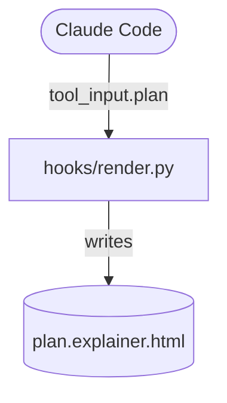

# plan-explainer

A teaching companion for plan mode. Alongside the plan (what will change), the model writes an
explainer: how the relevant code works today and why the plan changes it this way, with keyed
Mermaid diagrams and technical terms glossed in plain language. You read it in the browser while
the approval prompt waits.

## Why it attaches to plan mode instead of replacing it

Plan mode's read-only rule is enforced by Claude Code's permission layer: edits are blocked until
you approve, and a hook cannot unblock them. A skill running in auto mode could copy plan mode's
workflow, but not that guarantee — auto mode reviews calls with a classifier; it does not refuse
them. So the explainer is written into the one file plan mode allows (the plan), and a hook takes it
from there.

## Components

| Piece | What it does |
|---|---|
| `plan-explainer` skill | How to write the explainer: when to skip it, its four parts (code map, flow, design decisions, glossary), diagram rules, and the gloss-on-first-use language rule. |
| `render.py` hook (PreToolUse on `ExitPlanMode`) | Takes the plan's `## Explainer` section, writes two pages beside the plan file, and opens one in your browser. For a plan with no explainer, it writes nothing and removes any pages an earlier version of the plan left behind. |

The two pages are `<plan>.explainer.html`, a full document for the browser, and
`<plan>.artifact.html`, the same page as a fragment for the Artifact tool, which supplies its own
doctype and head. After you approve, the skill has the model publish the fragment as a private
Artifact.

## Writing one

The model appends this to the plan file; the skill has the full rules.

````markdown
## Explainer

### Code map


### Design decisions
#### Render in the page, not in Python
Chose client-side `marked` over a Python parser: the hook stays *stdlib-only* (nothing to install).
````

In a `flowchart` or `stateDiagram-v2`, tag nodes with `:::new`, `:::changed`, `:::existing`,
`:::external` or `:::data`. The page colours them and draws the key under the diagram.

## Legibility

Built for dark mode first, and correct in light mode and with an explicit theme toggle:

- Every colour in the page's CSS is a token with a light and a dark value. Each text pair is at
  least 4.5:1 in both themes, and each line or stroke is at least 3:1 (WCAG AA).
- Mermaid draws with the active theme's tokens and redraws when the theme changes. Role colours
  come from the page, never from the diagram source, so no diagram can pick a colour that reads in
  one theme only. Mermaid still hard-codes a few colours of its own inside the SVG for diagram
  features the explainer rarely uses.
- Diagrams draw after the web font loads, so labels are never sized for the fallback font and
  clipped.
- A wide diagram shrinks to 80% of natural size at most, then scrolls sideways under a visible hint.

The page loads `DOMPurify`, `marked`, `highlight.js` and `mermaid` from pinned CDN URLs with
Subresource Integrity hashes, and IBM Plex from Google Fonts, which cannot carry one. It needs a
network connection; offline, the explainer shows as plain text. Plans quote issue and repo text, so
the rendered HTML is sanitized with DOMPurify: a script or event handler in the explainer never
runs.

## Requirements and settings

- `python3` on `PATH` (stdlib only).
- `PLAN_EXPLAINER_NO_OPEN=1` writes the pages without opening a browser. On Linux the page opens
  only when `DISPLAY` or `WAYLAND_DISPLAY` is set, so a console browser never holds up the hook.
- The pages land beside the plan file: `~/.claude/plans/` unless your `plansDirectory` setting
  says otherwise. Point that inside a repo and the pages land in the repo too.

The hook never blocks: errors exit 1 (reported, not blocking), never 2.

## Tests

```bash
python3 -m unittest discover -s plugins/plan-explainer/tests
```
